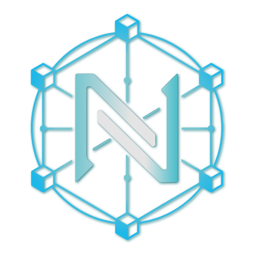

<div align="center">



# Nexo

**A Windows terminal built for driving AI coding agents,
with per-pane token and model instrumentation.**

<p>


</p>

<a href="https://github.com/joaobzrra/nexo-releases"><b>Download the Windows installer →</b></a>

</div>

---

## Why it exists

A normal terminal treats an agent session as an opaque stream of text. You
cannot see which model a pane is currently on, how many tokens it has burned, or
whether the thing that just got expensive was the thing you cared about.

Nexo instruments the pane. Each one reports its **model** and its **token usage**
as the session runs, so cost is visible while it is being spent — not
reconstructed afterwards from a billing page.

## How the telemetry works

`spike/collector/` is a small local HTTP collector. Agent CLIs report into it
through hook commands (`claude-hook.mjs`, `codex-telemetry.mjs`), and the app
binds each report to the pane that produced it.

The design constraint was privacy, and it is **enforced by tests rather than
intent**:

- The collector **requires authentication**, and its token is supplied at
  runtime, never compiled in — `spike/collector/server.mjs`
- It **retains only allowlisted payload fields**. Anything else in a report is
  dropped on arrival.
- Pane bindings are **privacy-minimal and exact**, and are never created for
  processes outside the app.

```console
$ node --test spike/collector/*.test.mjs
tests 9
pass 9
fail 0
```

The test names are the specification:

> *"collector requires authentication and never retains non-allowlisted payload
> fields"*
> *"does not create pane bindings outside AgentTerminal"*
> *"creates a privacy-minimal exact pane binding from Codex notify"*

## Release safety

`app/scripts/verify-package.mjs` scans the **packaged installer** before a
release for credential shapes and for the developer's own username, email and
absolute paths.

It exists because a personal identifier reaching a shipped public binary is a
different class of mistake from one reaching a source file — by then it is on
other people's machines.

`.github/workflows/release.yml` builds and publishes to the releases repo, with
every action pinned to a full commit SHA and the token referenced only as a
GitHub secret.

## What is not in this repository

The private source repository also carries a decision ledger, session handoffs
and a product foundation document. Those are working notes, not product, and
they stay private.

This repository is the application.

## Licence

MIT. See [LICENSE](LICENSE).
